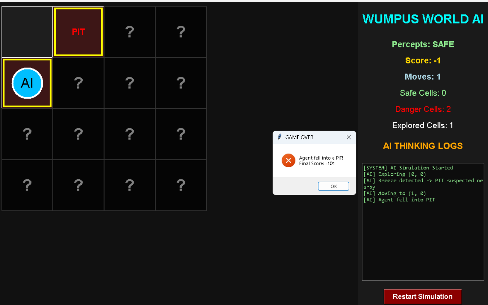
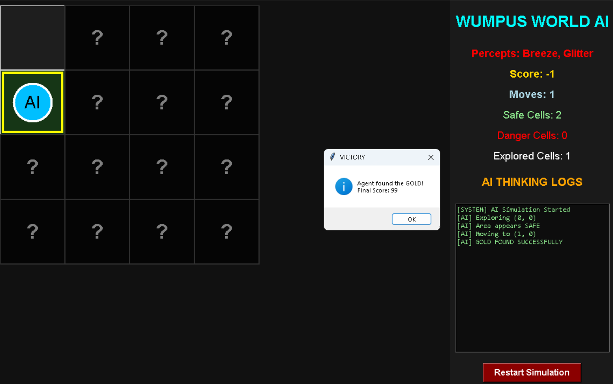
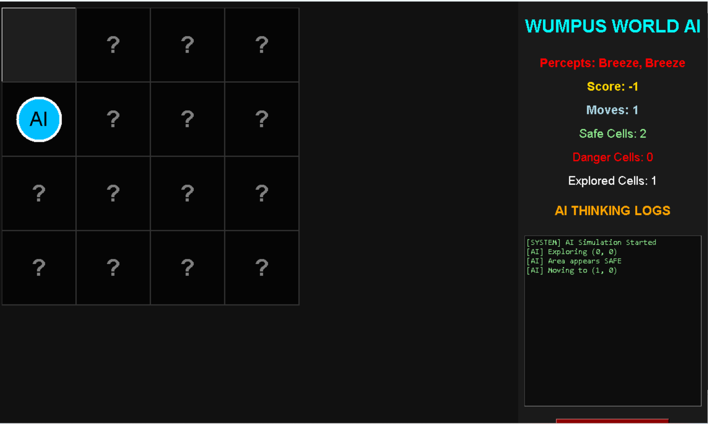

# 🏆 Wumpus World AI Simulation

A **knowledge-based AI agent simulation** built with Python and Tkinter. An autonomous agent explores a randomly generated Wumpus World — reasoning about pits, the Wumpus, and hidden gold from percepts alone, under a fog of war — while a live dashboard shows its knowledge, inference and score.

## ✨ Features

- **Autonomous AI Agent** — explores the world on its own, no human input
- **Knowledge-Based Reasoning** — maintains a knowledge base of visited cells and percepts (breeze, stench)
- **Inference Engine** — deduces safe cells and danger locations before moving
- **Random World Generation** — a new world layout every run
- **Fog of War Exploration** — the agent only "sees" what it has perceived
- **Smart Exploration System** — prefers provably safe moves, takes calculated risks only when needed
- **AI Thinking Logs** — live log of the agent's reasoning as it plays
- **Score System** — rewards gold discovery and efficient exploration
- **Professional Dashboard UI** — grid, knowledge state and logs in one Tkinter window

## 🧠 AI Concepts Used

- Knowledge-Based Agents
- Inference Engine
- Autonomous Agents
- Reasoning Under Uncertainty
- Environment Perception

## 🛠️ Technologies Used

- **Python**
- **Tkinter** (standard library — no external packages needed)

## 📸 Screenshots

### AI Simulation



### AI Exploring Environment



### Gold Discovery



## ▶️ How to Run

```bash
# Clone the repository
git clone https://github.com/arya123-sudo/wumpus-world-ai.git
cd wumpus-world-ai

# Run the simulation (Python 3, Tkinter included in the standard library)
python main.py
```

## 👤 Author

**Arya Yaligar** — [GitHub](https://github.com/arya123-sudo) · [LinkedIn](https://www.linkedin.com/in/arya-yaligar-ba15a2385)
